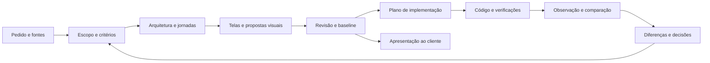

# Floorplan: planejamento, arquitetura e acompanhamento do projeto

**Data:** 2026-11-01. **Estado:** proposta aprovada para implementação, com política de privacidade corrigida pelo usuário: apenas o plugin pertence ao Git; todos os dados de projetos permanecem locais e ignorados.

**Objetivo:** tornar o nosso fork um instrumento contínuo de planejamento e validação: compreender o pedido, definir o escopo, desenhar arquitetura e telas, apresentar uma versão ao cliente, orientar mudanças e confrontar o que foi combinado com o que foi construído.

**Base examinada:** fork `guilhermexp/floorplan`, commit `d31d0d52cf7054a507041cb12d1f04d41a17eab6`, versão declarada 0.6.1. O inventário dos scripts, instruções, extensões e testes está no [documento complementar](2026-11-01-floorplan-inventory.md).

## 1. Recomendação

Manter o Floorplan como dono do planejamento e da experiência visual. Adaptar as partes pertinentes de Superpowers e Ponytail para um único fluxo de trabalho do Floorplan. Integrar Repowise como analisador externo opcional, com contrato explícito de evidências, atualização e limitações.

O investimento principal é um modelo que conecte **requisitos, decisões, arquitetura, telas, implementação e verificação**. Instalar três plugins e colocar seus nomes nas instruções não cria essa conexão.

A implementação deve preservar o canvas, a galeria, as propostas e capturas, o tour, a exportação e a execução local. Não exige uma nova aplicação web, um segundo canvas, uma plataforma de agentes ou um servidor público.

### Decisões de desenho recomendadas

| Decisão | Motivo |
|---|---|
| Um fluxo principal na skill Floorplan | Evita que três frameworks tentem controlar a mesma conversa, aprovação e execução. |
| Planejamento e observações do código coexistem | Uma funcionalidade ainda não construída não deve desaparecer após um scan. |
| IDs de domínio persistentes, independentes de caminhos | Renomear uma rota ou módulo não deve desligar seus mockups, decisões ou aprovações. |
| Revisões locais privadas; caches e saídas reconstruíveis separados | O escopo precisa sobreviver ao agente e à limpeza de cache, sem entrar no Git do plugin. |
| Repowise por CLI/MCP/API pública delimitada | Aproveita análise real sem incorporar sua aplicação e banco internos ao Floorplan. |
| Revisão proporcional ao risco e ao estágio | Ideias preliminares, arquitetura pronta e código implementado exigem verificações diferentes. |
| Apresentação ao cliente gerada de uma revisão identificada | O cliente deve saber exatamente qual versão está vendo. |

## 2. O que já existe e deve ser aproveitado

O produto atual tem uma cadeia coerente: o agente escreve a arquitetura e as descrições; os scripts extraem ou compilam fatos; `build.mjs` valida e produz o grafo; o viewer apresenta o resultado. Para planejamento, `planToScan` adapta arquivos e endpoints propostos ao formato do scanner. Essa reutilização é valiosa.

Também já existem pontos de extensão adequados:

- `window.Floorplan`: painéis, eventos, navegação, modais e botões usados pelas extensões atuais.
- `graph-query.js`: consultas compartilhadas entre viewer e CLI, além dos contratos de resposta do agente.
- `lib/blueprint.mjs`: validação estrutural do planejamento e revisão de endpoints, permissões e perguntas.
- `lib/screens.mjs` e `lib/visuals.mjs`: identificação de telas, relações com código e persistência dos visuais.
- `refresh.mjs`: comparação com o mapa anterior, reaproveitamento de descrições e indicação do que revisar.
- `serve.mjs`: respostas estruturadas do agente, aplicação validada de alterações e exportação.
- Testes existentes de blueprint, exportação, imagens, agentes e servidor.

Não devemos substituir isso por uma coleção paralela de comandos sem estado compartilhado.

## 3. Lacunas verificadas no fork

### 3.1 O blueprint começa cedo demais em arquivos

`references/blueprint.md` pede planejamento no nível de arquivos/endpoints. `planToScan` rejeita um plano sem arquivos. Isso funciona para uma solução já delineada, mas é inadequado como primeiro passo de um brainstorm ou levantamento com cliente.

**Mudança:** permitir evolução de conceito → escopo → arquitetura → plano técnico. Os primeiros estágios podem ter usuários, necessidades, jornadas, restrições e decisões sem inventar caminhos de código.

### 3.2 Requisitos e critérios de aceite não são entidades do produto

Hoje há `source`, `stack`, `assumptions`, `questions`, `files` e `endpoints`. Não há contrato para cobertura de requisitos, regras de negócio, aceite, riscos de produto e vínculo com evidências de verificação.

Uma sondagem local adicionou `requirements` a uma fixture: o compilador aceitou o documento sem erro, mas não transportou esse conteúdo para o scan. Acrescentar campos arbitrários ao JSON não basta.

**Mudança:** schema versionado e validadores que cubram armazenamento, prompts, CLI, grafo, UI e exportação. Campos essenciais desconhecidos devem produzir diagnóstico de incompatibilidade, sem descarte silencioso.

### 3.3 Planejado e observado usam a mesma saída intermediária

`plan.mjs` e `scan.mjs` escrevem `.cache/scan.json`. `refresh.mjs` escolhe o ramo blueprint ou código; `--from-code` mantém `plan.json`, mas o grafo exibido passa a representar o código. `graph.meta.blueprint` é um estado global. O modo Change do servidor só aparece para blueprint.

**Mudança:** compilar uma projeção conjunta de intenção e observação. Um projeto parcialmente implementado precisa continuar planejável, sem alternância destrutiva entre universos.

### 3.4 Atualização não equivale a acompanhamento semântico

O refresh compara hashes, mas a sinalização de descrição desatualizada considera nomes de símbolos, rotas e documentação. Uma alteração no corpo de uma função pode mudar uma regra de negócio sem mudar essa assinatura. Isso foi reproduzido em uma sondagem simples.

O servidor observa `index.html` para recarregar abas; não observa a árvore de código para reanalisar o projeto.

**Mudança:** manter a atualização barata de fatos e registrar impacto provável em requisitos/fluxos. Uma alteração detectada não prova, sozinha, conformidade nem violação de uma regra de negócio.

### 3.5 Identidades atuais não bastam para o ciclo inteiro

Telas usam `screen:<app>:<url>`; arquivos usam caminhos; endpoints no grafo usam posições `r:<índice>`. `visuals.json` conserva associações não resolvidas, o que evita perda de imagens, mas não oferece uma identidade de produto imune a mudanças de URL ou agrupamento.

**Mudança:** IDs persistentes para requisitos, telas, decisões e contratos; caminhos/URLs e IDs do viewer tornam-se referências e aliases. Correspondências ambíguas ficam pendentes em vez de unir entidades automaticamente.

### 3.6 Persistência é local, não um histórico de escopo

`keepOutOfGit` reescreve o `.gitignore` interno com `*`. Não resolve apenas editar esse arquivo manualmente: um próximo build o restaura. O Undo guarda somente os últimos 20 snapshots de três documentos em `.cache/history`. `recent-work.json` é substituído a cada atualização.

**Mudança:** manter a exclusão integral do Git e acrescentar revisões locais e baselines duráveis, fora de `.cache`. Undo, atividade recente e baseline de cliente têm finalidades distintas. Os dois primeiros não substituem o terceiro.

### 3.7 Exportação existente é uma base útil, mas técnica

O HTML exportado já abre sem agente, remove o caminho absoluto e remotes, e pode incorporar imagens. Ainda contém a estrutura técnica do grafo e não representa uma versão formal de escopo, inclusões/exclusões e aceite.

**Mudança:** projeção de apresentação ao cliente com seleção explícita de dados. Esconder campos pela interface não os remove do HTML enviado.

### 3.8 O contrato operacional atual também precisa evoluir

Os testes de distribuição afirmam que não há hooks, MCP ou dependências; a documentação promete isso. O Ask por Claude restringe Bash a `floorplan/query.mjs`; instalar Repowise fora do processo não o torna automaticamente acessível ao agente desse servidor.

**Mudança:** atualizar as instruções, os executores, a documentação e os testes juntos. Manter o modo básico só com Node; conexão externa habilitada e identificada por projeto. A integração deve funcionar tanto pelo agente principal quanto pelo Ask do mapa.

## 4. O que integrar de cada referência

As referências foram lidas como material de análise, não ativadas como políticas desta sessão. Versões examinadas:

| Referência | Commit |
|---|---|
| Superpowers | `2ce8aa15d05bd57213e6f746f953aafb7ded7a8b` |
| Repowise | `775a4e07e82eed299a3ee8dfe284e8dd00d98a6d` |
| Ponytail | `96608e078b2d5ea607c5c3b8b5a54d1c1fba6846` |

### Superpowers: método de planejamento e evidência

| Origem | Aproveitamento concreto | Encaixe no Floorplan |
|---|---|---|
| `brainstorming/SKILL.md` | Intenção, objetivos, exclusões, restrições e alternativas fundamentadas | Evoluir a entrada de `SKILL.md` e `references/blueprint.md`; registrar o resultado no modelo do projeto. |
| `builder-check-prompt.md` | Revisar se alguém conseguiria planejar a construção sem adivinhar decisões relevantes | Uma revisão de completude antes de considerar o escopo pronto. |
| `writing-plans/SKILL.md` | Tarefas com interfaces, arquivos afetados, dependências, critérios e verificações | Gerar o plano de execução a partir da revisão selecionada e de IDs de requisitos. |
| `verification-before-completion/SKILL.md` | Afirmações de conclusão sustentadas por resultados atuais | Estado “verificado” vinculado à evidência e à revisão testada. |
| `requesting-code-review/code-reviewer.md` | Conferir escopo e efeitos da implementação | Revisar mudanças com especificação, diff e código conectado. |

Não incorporar o bootstrap global de `using-superpowers`, seu servidor de visual companion ou a execução por subagentes como dependência obrigatória. O Floorplan já tem viewer/servidor, e o executor do usuário pode ter seu próprio fluxo. A entrega para implementação deve funcionar com ou sem Superpowers instalado.

A adaptação deve respeitar autorizações existentes: registrar decisões materiais e baselines não implica repetir perguntas a cada etapa mecânica. O agente pode escolher detalhes reversíveis dentro do escopo e registrá-los como escolhas técnicas.

Fontes: [brainstorming](https://github.com/obra/superpowers/blob/2ce8aa15d05bd57213e6f746f953aafb7ded7a8b/skills/brainstorming/SKILL.md), [writing-plans](https://github.com/obra/superpowers/blob/2ce8aa15d05bd57213e6f746f953aafb7ded7a8b/skills/writing-plans/SKILL.md), [verificação](https://github.com/obra/superpowers/blob/2ce8aa15d05bd57213e6f746f953aafb7ded7a8b/skills/verification-before-completion/SKILL.md), [bootstrap](https://github.com/obra/superpowers/blob/2ce8aa15d05bd57213e6f746f953aafb7ded7a8b/hooks/session-start).

### Repowise: observação e impacto do código existente

| Capacidade | Integração recomendada |
|---|---|
| `watch --index-only` / `update --index-only --working-tree` | Atualizar o índice sem regenerar prose com IA a cada salvamento. |
| `get_context`, `get_symbol` | Ler código relacionado, callers, referências e evidências para uma alteração. |
| `get_risk`, `get_change_risk` | Relacionar uma mudança às áreas e testes que merecem atenção. |
| `get_health`, `get_dead_code` | Alimentar achados com origem e confiança; manter as checagens específicas do Floorplan. |
| `get_why` e decisões | Importar evidências e candidatos a decisões; não converter inferência histórica em aprovação do cliente. |
| `doc-drift` | Verificar referências documentais resolvíveis; complementar a comparação semântica própria do Floorplan. |
| Metadados de atualidade, degradação e omissão | Mostrar quando a análise está velha, incompleta ou indisponível. |

**Limites concretos encontrados:**

1. O endpoint visual de exportação de grafo retorna apenas nós de arquivos e limita a seleção: padrão 1.500, máximo 6.000, com `truncated`. Não pode ser a fonte única de inventário ou prova de completude.
2. As respostas MCP também têm orçamento de conteúdo e mecanismos de recuperação. O adaptador precisa respeitar `dropped_targets`, totais e referências de omissão; lista truncada não autoriza marcar o restante como ausente.
3. `doc-drift` só cobre referências que o detector resolve. Isso não valida regras como prazo de cancelamento, cálculo de preço ou autorização efetiva em execução.
4. Há discrepância documental: `AUTO_SYNC.md` descreve o sync HTTP como sem custo de modelo; `API_REFERENCE.md` e `job_executor.py` mostram que o modo `sync` pode regenerar páginas se houver provider. A integração deve usar explicitamente o caminho index-only e validá-lo, sem inferir ausência de custo pelo nome “sync”.
5. Configurações/instalação do Repowise podem alterar hooks e instruções de agentes. O setup controlado do Floorplan deve usar opções para não instalar esses componentes automaticamente e só configurar o necessário ao projeto.

O primeiro adaptador deve enriquecer o inventário nativo do Floorplan. Ele não precisa substituir imediatamente a descoberta de telas, o casamento de HTTP ou os checks específicos de Firebase/Supabase/Stripe. Cada relação importada conserva origem e revisão; discordâncias não são resolvidas por uma preferência silenciosa.

Para o agente principal, usar MCP se disponível. Para o agente restrito do mapa, preferir uma consulta de contexto do próprio Floorplan que entregue os mesmos dados normalizados. O servidor prepara evidências ou oferece um comando de leitura delimitado; não se libera shell geral para contornar a restrição atual.

Fontes: [MCP](https://github.com/repowise-dev/repowise/blob/775a4e07e82eed299a3ee8dfe284e8dd00d98a6d/docs/agent/MCP_TOOLS.md), [campos das respostas](https://github.com/repowise-dev/repowise/blob/775a4e07e82eed299a3ee8dfe284e8dd00d98a6d/docs/reference/MCP_RESPONSE_FIELDS.md), [watcher](https://github.com/repowise-dev/repowise/blob/775a4e07e82eed299a3ee8dfe284e8dd00d98a6d/packages/cli/src/repowise/cli/commands/watch_cmd.py), [grafo limitado](https://github.com/repowise-dev/repowise/blob/775a4e07e82eed299a3ee8dfe284e8dd00d98a6d/packages/server/src/repowise/server/routers/graph/full_graph.py), [doc-drift](https://github.com/repowise-dev/repowise/blob/775a4e07e82eed299a3ee8dfe284e8dd00d98a6d/packages/core/src/repowise/core/analysis/doc_drift/constants.py), [execução do sync](https://github.com/repowise-dev/repowise/blob/775a4e07e82eed299a3ee8dfe284e8dd00d98a6d/packages/server/src/repowise/server/job_executor.py).

### Ponytail: revisão contextual e limites assumidos

| Origem | Aproveitamento concreto | Encaixe |
|---|---|---|
| `ponytail/SKILL.md` | Reutilizar o que existe; evitar abstrações e dependências especulativas | Critérios da revisão de arquitetura e das propostas de mudança. |
| `ponytail-review/SKILL.md` | Conferir também callers e efeitos fora do diff; exigir caso concreto | Revisão de alterações ligada aos achados e requisitos afetados. |
| `ponytail-audit/SKILL.md` | Priorizar correção, segurança, carga esperada, testes, desempenho e simplicidade | Diagnóstico inicial de projeto existente ou revisão ampla solicitada. |
| `ponytail-debt/SKILL.md` | Tornar explícito o limite de uma simplificação e o gatilho para revê-la | Decisões do projeto com justificativa, limite e condição de revisão. |

Um arquivo grande, uma fila ou um serviço separado não são erros por definição. A revisão deve explicar a necessidade atendida, a carga esperada, a alternativa mais simples e o custo de mudar. Não adotaremos quantidade de linhas removidas como meta de qualidade.

Não incorporar seus hooks de ativação persistente, rastreadores de modo, statusline e métricas de “ganho”: isso criaria outro controlador de sessão e não ajuda a estabelecer o escopo do cliente.

Fontes: [princípios](https://github.com/DietrichGebert/ponytail/blob/96608e078b2d5ea607c5c3b8b5a54d1c1fba6846/skills/ponytail/SKILL.md), [review](https://github.com/DietrichGebert/ponytail/blob/96608e078b2d5ea607c5c3b8b5a54d1c1fba6846/skills/ponytail-review/SKILL.md), [audit](https://github.com/DietrichGebert/ponytail/blob/96608e078b2d5ea607c5c3b8b5a54d1c1fba6846/skills/ponytail-audit/SKILL.md), [debt](https://github.com/DietrichGebert/ponytail/blob/96608e078b2d5ea607c5c3b8b5a54d1c1fba6846/skills/ponytail-debt/SKILL.md).

### Reutilização e manutenção das referências

Superpowers e Ponytail declaram MIT; Repowise declara AGPL-3.0. A proposta técnica usa Repowise como ferramenta externa e não copia seus pacotes para o fork. Essa separação não deve ser apresentada como conclusão jurídica sobre qualquer distribuição futura. Licenças consultadas: [Superpowers](https://github.com/obra/superpowers/blob/2ce8aa15d05bd57213e6f746f953aafb7ded7a8b/LICENSE), [Ponytail](https://github.com/DietrichGebert/ponytail/blob/96608e078b2d5ea607c5c3b8b5a54d1c1fba6846/LICENSE), [Repowise](https://github.com/repowise-dev/repowise/blob/775a4e07e82eed299a3ee8dfe284e8dd00d98a6d/LICENSE).

Trechos adaptados das skills MIT devem ter atribuição e referência ao commit, preservando os avisos aplicáveis. Registrar o que foi adaptado, em vez de copiar o catálogo completo ou acompanhar `main` automaticamente. A versão do Repowise suportada será fixada após uma prova de compatibilidade executada, não apenas pela leitura feita aqui.

## 5. Modelo de projeto e responsabilidade pelos dados

O Floorplan deve ter um só dono das regras de gravação, validação e revisão do projeto. Isso não significa um JSON gigantesco contendo imagens, cache e código.

| Documento/dado | Dono | Natureza |
|---|---|---|
| `plan.json` versão 2 | Floorplan: intenção | Objetivo, usuários, escopo, requisitos, critérios, decisões, telas planejadas e contratos. |
| `architecture.json` | Floorplan: desenho da solução | Partes, responsabilidades, relações declaradas, jornadas/fluxos e tour. Referencia IDs do plano. |
| `visuals.json` e `visuals/` | Floorplan: evidências visuais | Propostas/capturas, associação estável, metadados e histórico de revisão. |
| `descriptions/*.json`, anotações e fluxos customizados | Floorplan: contexto autoral | Continuam preservados; precisam referenciar identidades migráveis. |
| `reviews/` | Floorplan: revisões | Achados, evidências, decisões de triagem e revisão a que se aplicam. Não é uma segunda especificação. |
| `baselines/` | Floorplan: versões entregues | Snapshot imutável do escopo selecionado e referências/hash dos visuais incluídos. |
| `.cache/observed/` | Scanner / adaptador | Fatos observados, reconstruíveis, com revisão, cobertura, origem e erros. |
| `.cache/assessment.json` | Comparação do Floorplan | Diferenças e verificações calculadas; não reescreve intenção. |
| `graph.json`, HTML, textos de apresentação | Build / export | Projeções reconstruíveis desses mesmos dados. |

PRDs existentes continuam como entradas e referências, com caminho e hash da versão importada. Um texto de especificação gerado do plano deve ser identificado como projeção. Se o usuário editar uma fonte externa, isso gera uma proposta de atualização, não dois documentos simultaneamente tratados como verdade atual.

As decisões novas pertencem ao plano. ADRs já existentes podem ser importados com sua origem e revisão; decisões inferidas pelo Repowise são candidatos. Não manter uma segunda cópia editável das mesmas decisões no banco do Repowise.

### Entidades mínimas

O schema exato será fechado na primeira etapa de implementação. O contrato precisa garantir:

- **Requisito:** ID, comportamento, fonte, prioridade, escopo e critérios de aceite identificados.
- **Decisão:** ID, questão, escolha, justificativa, alternativas pertinentes, alcance e condição de revisão.
- **Tela:** ID persistente, estados relevantes, público, relações com requisitos e referências técnicas opcionais.
- **Implementação observada:** repositório, caminho/símbolo/rota, revisão, origem e vínculo confirmado ou sugerido com uma entidade planejada.
- **Evidência:** o que foi verificado, método, resultado, data e revisão exata; teste planejado não equivale a teste executado.
- **Achado:** entidade afetada, tipo, evidência, gravidade, confiança quando fornecida, estado e motivo da triagem.
- **Baseline:** ID/revisão, conteúdo e hashes, data, público e registro de aceitação somente quando houver evidência real dela.

IDs de arquivos/rotas do viewer podem continuar como referências de navegação. A identidade persistente não deve depender da posição de um endpoint no array nem do texto de uma URL.

### Estados separados

Não condensar tudo em um único “aprovado”:

| Eixo | Exemplos de estado |
|---|---|
| Decisão de escopo | rascunho, em revisão, aceito, substituído |
| Implementação | desconhecida, não observada, parcial, observada |
| Verificação | não verificada, passou, falhou, desatualizada |
| Associação de código | confirmada, sugerida, ambígua |
| Visual | proposta ou captura; revisão própria |

Um mockup aprovado não aprova automaticamente a arquitetura. Encontrar um arquivo não comprova a funcionalidade. Um screenshot demonstra aquele estado visual naquela execução.

## 6. Fluxo único de uso



### Projeto novo

O agente lê o pedido e as fontes; registra objetivos, exclusões e dúvidas materiais; desenha jornadas e responsabilidades; detalha arquitetura conforme o entendimento amadurece; vincula mockups; revisa completude e simplicidade; gera a apresentação e, quando solicitado, o plano de implementação.

Não se exige escolher todos os arquivos antes de conversar sobre o problema. O plano técnico posterior precisa informar os requisitos atendidos, dependências, interfaces, verificações e a revisão do escopo de que partiu.

### Projeto existente

Primeiro observar o código e marcar a cobertura real. Requisitos deduzidos do funcionamento são hipóteses para confirmação, não especificações aprovadas retroativamente. Registrar a diferença entre “encontrado no código”, “declarado em documento” e “confirmado pelo responsável”.

### Modificação em projeto existente

Produzir uma proposta ligada à revisão atual: requisito afetado, motivo, impacto, telas, contratos e testes. Depois de aplicada, reobservar a implementação e atualizar evidências. Mudanças feitas fora do Floorplan devem aparecer como diferenças a reconciliar.

### Retomada por outro agente

O contexto inicial deve informar revisão do plano, baseline vigente, código observado, atualidade da análise e pendências relevantes. `recent-work.json` permanece um resumo; não é a memória única do projeto. A configuração de cada projeto informa onde estão seus artefatos, sem misturar dois clientes ou dois worktrees.

### Exemplo sintético: conversa sobre uma reserva

Exemplo ilustrativo, **não um requisito já aprovado**: permitir que tutor e passeador conversem sobre uma reserva.

1. Registrar o requisito e os critérios de participantes autorizados, entrega e estados de erro. As dúvidas de negócio ficam explícitas.
2. Ligar o requisito à jornada da reserva e à tela “Chat da reserva”, mantendo sua imagem como proposta.
3. Explicar as responsabilidades da solução e avaliar se um serviço separado é necessário à carga esperada. A revisão inspirada no Ponytail fundamenta essa escolha.
4. Incluir requisito, fluxo e proposta visual na versão de escopo enviada ao cliente.
5. Ao existir código, scanner e Repowise fornecem referências de UI, autorização, transporte e persistência. Essa observação alimenta a mesma tela do Floorplan.
6. Testes de acesso e comportamento, mais uma captura datada, sustentam o estado verificado daquela revisão. A imagem sozinha não comprova isolamento entre reservas.
7. Um pedido posterior de mensagens de áudio vira alteração de escopo com impacto, decisões e nova versão; não modifica retroativamente a entrega anterior.

Assim, o método de planejamento, a análise do código e a revisão de arquitetura atuam sobre a mesma entidade de produto.

## 7. Atualização automática e reconciliação

### Propriedade dos processos

Uma única configuração por projeto define quem acompanha o código. Com Repowise habilitado, aproveitar seu watcher; não executar um segundo watcher que também regenere o índice. O Floorplan consome resultados concluídos e atualiza sua projeção. O modo nativo permanece utilizável sem Repowise.

A leitura de uma nova geração deve usar metadados estruturados, não interpretação de mensagens do terminal ou leitura direta do banco interno do Repowise. Se a interface disponível não permitir verificar a atualidade/coerência de um conjunto de respostas, a análise fica marcada como parcial/desatualizada.

### Contrato de observação proposto

```ts
type Observation = {
  provider: 'floorplan' | 'repowise';
  providerVersion: string;
  projectId: string;
  repoId: string;
  revision: {
    commit?: string;
    workingTreeHash?: string;
    providerRevision?: string;
  };
  capturedAt: string;
  coverage: {
    filesSeen: number;
    filesAnalyzed: number;
    excluded: Array<{ path: string; reason: string }>;
    unresolved: number;
    truncated: boolean;
  };
  freshness: 'current' | 'stale' | 'unknown';
  degraded: string[];
  facts: unknown[]; // tipos normalizados por capacidade; não expor schemas externos à UI
};
```

É um esboço de contrato, não uma API já criada. A cobertura é por capacidade: detectar um arquivo não implica analisar seus símbolos, chamadas, saúde e regras de negócio. Falha na análise nunca vira resultado limpo.

### Tratamento das diferenças

| Sinal | Resultado esperado |
|---|---|
| Código novo sem vínculo | Sugerir associação ou apontar possível mudança de escopo. |
| Arquivo/rota planejada ainda ausente | Manter como planejado; não é defeito durante a implementação. |
| Endpoint renomeado | Migrar vínculo inequívoco; pedir revisão de candidatos ambíguos. |
| Corpo de função alterado | Marcar critérios e fluxos relacionados para revisão de impacto. |
| Regra de negócio possivelmente divergente | Exigir leitura/teste/evidência antes de afirmar violação. |
| Fonte editada durante a análise | Invalidar resultado misto e programar nova análise. |
| Captura anterior à alteração relevante | Marcar como possivelmente desatualizada; preservar a imagem. |
| Provedor indisponível ou resposta truncada | Preservar último resultado identificado e mostrar limite; não apagar entidades. |

O watcher atualiza fatos e estado de atualidade. Revisões com IA acontecem por lote relevante ou solicitação, evitando uma análise completa a cada tecla. A frequência e o custo devem ser observáveis.

### Escrita consistente

Todas as entradas — CLI, UI e propostas do agente — devem usar o mesmo mecanismo de aplicação:

1. Ler revisão de base.
2. Preparar alteração e delta legível.
3. Validar referências, schema e precondições.
4. Rejeitar conflito se a revisão mudou.
5. Gravar o conjunto coerente, com recuperação em caso de interrupção.
6. Reconstruir as projeções a partir da revisão publicada.

Pode-se continuar aceitando documento completo no protocolo do agente inicialmente, desde que ele informe a revisão de base e passe pela mesma aplicação. Não é necessário inventar uma linguagem de patches para obter controle de concorrência.

As gravações de visuais já têm lock e rollback próprios. Integrá-las a essa revisão comum deve preservar essas garantias e evitar concorrência entre importação, Change e rebuild. Leitores devem acessar uma revisão completa; não combinar `graph.json` novo com HTML antigo.

## 8. Entrega e validação com clientes

“Apresentação”, “Projeto” e “Implementação” são visões dos mesmos dados, não produtos separados.

Uma entrega de cliente deve incluir:

- Objetivo e problema atendido.
- Público e jornadas principais.
- O que está incluído, fora do escopo e ainda em aberto.
- Telas e estados com propostas visuais identificadas.
- Explicação acessível da arquitetura e integrações externas.
- Critérios que demonstrarão a conclusão.
- Dependências do cliente e decisões necessárias.
- Revisão/data e estado explícito: rascunho, em revisão ou aceito.

O tour, o canvas e a galeria atuais são reaproveitados. A exportação deve receber uma baseline imutável, não “o último grafo que estiver na pasta”. Reabrir uma entrega antiga não a transforma no novo escopo.

**Projeção de dados:** construir um objeto de exportação com campos permitidos. Caminhos locais, dados internos de revisão, credenciais, prompts e informações técnicas não escolhidas não devem existir no payload. `audience: everyone` hoje muda a linguagem, mas não é uma política de seleção de conteúdo.

**Imagens:** preservar originais; gerar derivados adequados à apresentação e carregar miniaturas sob demanda. Uma galeria grande precisa de teste real de tamanho e memória. O HTML único continua útil; para grandes apresentações, um pacote estático com assets locais pode ser mais apropriado. A escolha deve ser baseada no tamanho medido, sem comprimir ou cortar originais destrutivamente.

**Aceitação:** registrar quem aceitou, qual versão e qual evidência confirma a decisão. Um botão num HTML offline não sincroniza uma aceitação com o projeto. Na primeira entrega, o feedback pode ser recebido externamente e registrado pelo responsável. Comentários colaborativos, autenticação e hospedagem são uma etapa própria, se necessários.

## 9. Pontos de implementação no repositório

| Área existente | Intervenção prevista |
|---|---|
| `SKILL.md` e cinco guias em `references/` | Um fluxo por estágio; formatos v2; uso de contexto/evidências; instruções proporcionais e em português por padrão. |
| `lib/blueprint.mjs`, `plan.mjs` | Validar o plano v2 e compilar suas projeções; aceitar conceito sem arquivos; manter leitura de v1. |
| `scan.mjs`, `refresh.mjs`, `status.mjs`, `recent.mjs` | Separar observação de intenção; atualizar por revisão; resumir pendências sem destruir o planejamento. |
| `build.mjs` | Compor as camadas, validar vínculos e publicar uma revisão coerente do grafo/HTML. |
| `lib/screens.mjs`, `lib/visuals.mjs` | IDs persistentes, aliases e evidências de revisão; migração das associações atuais. |
| `graph-query.js`, `query-cli.mjs` | Consultas de requisitos, diferenças e contexto, com atualidade e cobertura. |
| `serve.mjs` | Submeter mudanças ao mesmo dono do projeto; preparar contexto do analisador; exportar baseline. |
| `06-blueprint.js`, `20-health.js`, `25-recent.js`, `30-screens.js`, `35-visuals.js` | Mostrar estágio, associações e achados coerentes, reaproveitando painéis existentes. |
| `40-tour.js`, `60-export.js` e viewer | Visão de cliente e navegação entre requisito, fluxo e tela; exportação derivada da baseline. |
| `01-language.js`, `10-glossary.js` | Textos novos via tradução explícita; evitar depender de substituição automática de texto para novas entidades. |
| `lib/common.mjs` | Preservar a exclusão integral do Git; revisões locais privadas não dependem de commits. |
| Manifests, `openai.yaml`, docs e testes de distribuição | Descrever o fork real, recursos novos e integração opcional; preservar atribuição upstream. |

### Poucos módulos novos, com responsabilidade completa

Nomes abaixo são propostos, não existentes:

- **`lib/project.mjs`:** ler, migrar, validar e aplicar revisão autoral; gerir baseline. CLI e servidor compartilham esse dono.
- **`lib/assessment.mjs`:** comparar intenção, observações e evidências; produzir diferenças/achados sem mutar intenção.
- **`lib/repowise.mjs`:** capacidades, transporte, compatibilidade e normalização do provedor externo. Nenhum componente de UI conhece o banco/schema dele.
- **`lib/export.mjs`:** projeção de audiência e composição da entrega, extraindo a responsabilidade hoje dentro de `serve.mjs`.

Um comando de entrada pode expor essas operações sem exigir que o usuário memorize os nove scripts. Os scripts atuais continuam como compatibilidade durante a migração e deixam de ter caminhos próprios de escrita para o mesmo contrato. Evitar criar classes, registries ou um SDK de provedores antes de existir uma segunda necessidade concreta.

Para o agente, a interface conceitual é: **obter contexto → propor alteração → validar/aplicar → observar → verificar → exportar**. MCP próprio do Floorplan não é pré-requisito: uma CLI estruturada compartilhada já atende o fluxo local. Um MCP futuro deve usar o mesmo contrato, se outro host realmente precisar dele.

## 10. Migração e continuidade

1. Identificar versão e criar backup verificável antes de migrar.
2. Ler `plan@1`/`architecture@1` sem mudar seu significado. Assumptions antigas não viram decisões aceitas automaticamente.
3. Atribuir IDs persistentes e registrar aliases para as telas, caminhos e rotas antigos.
4. Migrar vínculos de visuais, flows, notas e revisões; conservar casos não resolvidos com diagnóstico.
5. Preservar o significado histórico de `approved: true` em visuais antigos, mas marcar autoria/data de aceitação como desconhecidas quando não existem. Não inventar proveniência.
6. Manter a pasta inteira do projeto ignorada, incluindo documentos, imagens, revisões, baselines e caches. Nenhum modo tracked é introduzido.
7. Guardar versões locais em `revisions/` e `baselines/`, separados do cache. Backup e exportação são explícitos; não publicar ou adicionar os dados ao Git do plugin nem ao Git de um projeto por iniciativa do plugin.
8. Rebuild deve preservar byte a byte os assets originais. Comparar contagens, hashes e vínculos antes/depois.

O caso real de aceitação será validado fora deste repositório, comparando contagens, hashes e vínculos antes/depois. Seus arquivos e dados não fazem parte do código do plugin.

## 11. Sequência de implementação e critérios de saída

| Etapa | Entrega integrada | Critério para avançar |
|---|---|---|
| 1. Núcleo de projeto | Schema v2, IDs, persistência e migração; um dono de gravação | O projeto local conserva todos os visuais/vínculos; plano v1 abre; conflito de revisão não sobrescreve trabalho. |
| 2. Planejamento guiado | Entrada por estágio, requisitos/aceite, decisões e plano de execução referenciado | Um projeto vazio produz escopo útil sem arquivos fictícios; cada requisito tem critério e destino ou lacuna explícita. |
| 3. Entrega ao cliente | Baseline e apresentação com tour/galeria e escopo | Export abre offline; sua revisão fica fixa; conteúdo interno omitido não está no payload; a galeria grande permanece navegável. |
| 4. Planejado + observado | Projeção conjunta, associação e diferenças usando scanner nativo | Implementação parcial mantém o restante planejado; remoções/renomes ficam visíveis; captura não significa requisito verificado. |
| 5. Repowise real | Adaptador, contexto para agentes e atualização acompanhada | Prova em checkout isolado confirma alterações sem commit, deleções, renomes, versão suportada, dados incompletos e recuperação. |
| 6. Revisão contínua | Critérios do Ponytail, evidências e triagem no mesmo painel | Achados explicam caso/impacto/solução; dispensas têm motivo e escopo; mudança relevante reabre revisão; sem auto-refatoração. |

O estudo do contrato do adaptador acontece desde o núcleo, para não impedir a etapa 5. Sua instalação e comportamento real precisam de um spike isolado antes de declarar a integração suportada. O blueprint para cliente já entrega valor antes de exigir Python, índice ou serviços externos.

### Casos de validação obrigatórios

- Projeto novo sem código; requisito não funcional; dúvida material não resolvida; mudança de escopo depois de uma baseline.
- Aplicativo existente sem documentação: inferência identificada e cobertura incompleta visível.
- Implementação parcial; dois serviços com endpoints de mesmo método/URL; dois clientes/worktrees sem misturar estado.
- Renomear URL, arquivo e módulo mantendo mockups; correspondência ambígua não reatribui imagem errada.
- Mudar só uma regra dentro de uma função mantendo assinatura: sinalizar impacto, sem alegar conformidade automática.
- Atualização concorrente por UI/CLI/watcher; interrupção entre gravações; retomada sem publicar estado misto.
- Repowise ausente, antigo, lento, com erro, com índice desatualizado e respostas truncadas; nenhuma dessas situações vira “tudo certo”.
- Export de baseline antiga após alterar o plano; imagens locais sem rede; conteúdo privado ausente no JSON exportado.
- Aceitação registrada sem evidência é recusada; arquivo observado sem teste fica não verificado; aprovação visual não aprova regras.
- Regressão dos testes atuais e verificação real de galeria/canvas nos tamanhos suportados. Testes de string/HTML não substituem essa prova visual.

## 12. Alternativas avaliadas

| Alternativa | Avaliação |
|---|---|
| Instalar os três plugins e chamar suas skills | Útil para experimentar, mas não resolve estado compartilhado, IDs, divergências ou entregas versionadas. |
| Copiar pacotes inteiros para dentro do fork | Aumenta manutenção e acoplamento, traz runtimes e obrigações de distribuição; não justificado. |
| Usar Repowise como fonte única do produto | Sua análise de código ajuda muito, mas planejamento anterior ao código e aceite do cliente continuam exigindo um modelo próprio. |
| Reescrever o Floorplan como plataforma nova | Desperdiça canvas, export, testes e visuais já funcionais. |
| Evoluir o núcleo existente e integrar capacidades delimitadas | Recomendado: preserva a experiência e dá um caminho verificável para a visão de ciclo completo. |

## 13. Evidência obtida e limites desta análise

- Inventariados os 9 scripts principais, 11 bibliotecas, 11 extensões de UI, 5 guias, runtime, manifests e infraestrutura de testes. Aprofundados os caminhos que controlam planejamento, atualização, vínculos, execução de agentes e exportação; isso não é uma auditoria linha a linha de todos os parsers e do layout vendorizado.
- Executada a suíte atual: **175 testes; 174 passaram; 0 falharam; 1 ignorado**. O teste ignorado é específico da descoberta do executável Claude no Windows, fora do ambiente macOS usado. Execução local de aproximadamente 10,8 segundos. Não prova compatibilidade com as integrações propostas.
- Sondagens isoladas confirmaram: requisitos extras não chegam ao scan; conceito sem arquivos é rejeitado; alteração só no corpo mantém a assinatura usada para revisão de descrições; helper de build restaura ignore total.
- Conferidos fora deste repositório os totais e associações de um projeto real, sem incluir seus dados no plugin.
- Referências externas consultadas por documentação e código em commits identificados. Repowise, Superpowers e Ponytail não foram instalados nem executados nesta análise; nenhum benchmark de terceiros foi tratado como resultado nosso.
- Não foi criado servidor público, sincronização recorrente, aprovação de cliente ou integração funcional. Os únicos artefatos novos são estes documentos de análise.

**Resultado recomendado:** começar pelo núcleo de projeto e pela continuidade de identidade/revisão. Em seguida, conectar o método de planejamento, a apresentação ao cliente e a observação do código a esse mesmo núcleo. Isso dá às ferramentas referenciadas um lugar definido e verificável dentro do Floorplan.
